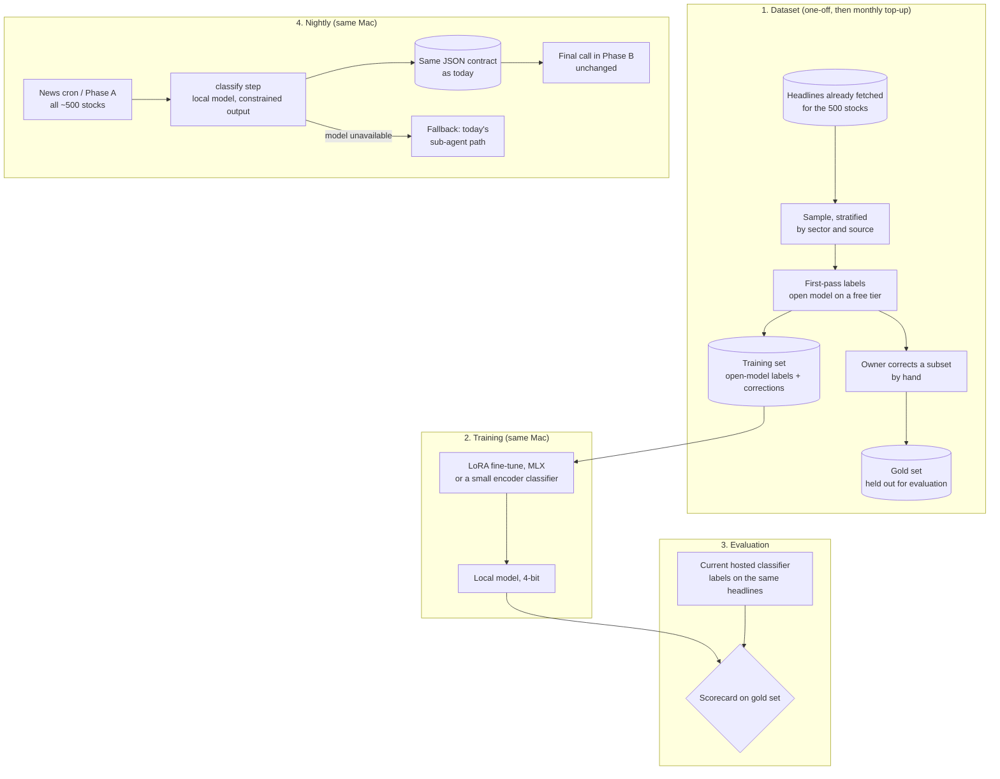

# Design: a local fine-tuned news classifier for VivaTrades

*Proposal, not built. Part of the [design proposals](README.md); the system it
changes is described in [Keeping 500 stocks analysed on 100 LLM runs a night](../vivatrades-nightly-analysis.md).*

Status: **proposal, for owner review.** No code, prompt, schedule or data has
changed. Written 2026-11-03.

## 1. Summary

Replace the news-classification step of the nightly pipeline, today a
sub-agent call to a small hosted model inside the coding-agent session, with a
**small fine-tuned model running on the same machine that already runs the
pipeline**.

- **No hosting.** The pipeline already runs on the owner's Mac under launchd,
  so the model runs where the job runs. Nothing to deploy, nothing to pay for.
- **It stops being an agent.** Classification becomes a deterministic step: a
  script that calls a local model and writes the same JSON the downstream stage
  already reads. That is the same move that took the pipeline from seven model
  calls per stock to two.
- **It frees the rolling cap.** One of the two remaining model calls per stock
  leaves the flat-rate subscription.
- **It can cover all 500 stocks, not 100.** A free local classifier no longer
  has to wait for a stock's turn in the expensive phase, so every stock's news
  can be classified every day.
- **Training data is labelled by an open model and corrected by hand.** No
  outputs from the current hosted model are used as training data.

The decision asked of the owner is in [section 11](#11-decisions-for-the-owner).

## 2. Why this step first

The expensive phase makes two model calls per stock:

| Call | Job | Today |
| --- | --- | --- |
| News classification | Label up to 8 filtered headlines per stock: sentiment (positive / negative / neutral) and importance (high / medium / low), as JSON. No prose | Small, fast hosted model, as a sub-agent |
| Final | Read the assembled draft, classify risk and write the published narrative under the "describe, never prescribe" rule | Larger hosted model |

Classification is the textbook fine-tuning job: narrow, fixed labels, fixed
output shape, high volume (up to about 800 headlines a night at 100 stocks)
and low judgement. Its rubric is already written down, including the rule
"when unsure, neutral / low". A model with that rubric in its weights does not
need it in a prompt, and a model whose only output is two labels can be forced
to emit nothing else.

The final call is the opposite: open-ended prose, about real companies, under
a regulatory line. It is the last thing to move, if ever (section 9).

## 3. Goals and non-goals

Goals

1. Agreement with a hand-labelled gold set **at least as good as the current
   hosted classifier**, measured on the same headlines.
2. Valid output on 100% of calls: every headline gets exactly one sentiment
   and one importance from the allowed values.
3. Zero recurring cost and no new infrastructure.
4. Classification for all ~500 stocks daily, not only the ~100 in the
   expensive phase.

Non-goals

- Changing the narrative writer.
- Changing the downstream JSON contract. Whatever reads classified news today
  keeps reading the same shape.
- Serving anything to the public from the Mac. The Mac already runs batch
  jobs; it does not start serving web traffic.

## 4. Constraints

| Constraint | Consequence |
| --- | --- |
| No paid services | Local model only; training on the same Mac (Apple M5, 24 GB) |
| **Hosted-model outputs cannot be training data.** Anthropic's Usage Policy prohibits using outputs "to train an AI model (e.g., 'model scraping' or 'model distillation') without prior authorization" | Past labels from the current classifier are excluded from training. They may be used as a **comparison baseline** in evaluation, which trains nothing |
| Open-model outputs are usable | An open-weight model (for example gpt-oss on Groq's free tier, Apache 2.0) can produce first-pass labels |
| Headlines are third-party text | The dataset stays private (never in a public repository); it holds titles, sources and dates, not article bodies |
| Public sentiment datasets carry licences | The best known, Financial PhraseBank, is licensed non-commercial (CC BY-NC-SA 3.0). Do not use any public set without checking its licence |
| The machine is shared with the nightly jobs | The model must be small: a 1–3B model in 4-bit is about 1–2 GB of memory |

## 5. Architecture

### 5.1 Dataset

- **Source.** Headlines the pipeline has already fetched, sampled across
  sectors, sources and market conditions, so the set is not dominated by a
  handful of large caps.
- **First pass.** An open-weight model labels each headline against the
  existing rubric. At roughly 50–100 tokens per headline, a few thousand
  headlines fit comfortably in a free tier over a day or two.
- **Owner pass.** The owner corrects a stratified subset, 300–500 headlines.
  This is where the product's own definition of *importance* comes from; it is
  the most valuable part of the dataset and the part no public set provides.
- **Gold set.** A slice of the hand-checked headlines is held out and never
  trained on. Everything is scored against it.
- **Top-up.** News topics drift. A small monthly top-up (fresh headlines, a
  few dozen hand checks) keeps the model current.

### 5.2 Model

Two candidates, chosen by the phase-2 scorecard rather than in advance:

1. **A small instruct model with a LoRA adapter** (1–3B parameters), fine-tuned
   with [MLX-LM](https://github.com/ml-explore/mlx-lm), asked for exactly two
   labels per headline. Output constrained to the allowed values, so an invalid
   label is impossible rather than merely unlikely.
2. **A small encoder classifier** (two classification heads on a compact
   encoder). Cheaper and faster, and a classification task is what encoders are
   for; it cannot write a stray word at all.

Either runs in well under a second per headline on the Mac, so 800 headlines a
night is minutes, and 4,000 (all 500 stocks) is still minutes.

### 5.3 Where it runs in the pipeline

Classification moves **out of the agent session and into the deterministic
side**: the news cron or Phase A calls the local model for every stock and
writes the classified JSON. Phase B then finds classification already done and
skips the sub-agent. Effects:

- the subscription is no longer spent on classification;
- classified news exists for all ~500 stocks every day, so the public page can
  show it even for stocks whose narrative is days old;
- the expensive phase gets shorter, which lowers the chance of a long session
  dying mid-run, the failure the run split already guards against.

### 5.4 Fallback and health

- If the local model is unavailable or errors, the step writes nothing for that
  stock, and Phase B classifies it the way it does today. The fallback is the
  absence of a file, not a flag.
- The existing output-count check gains a second count: stocks with classified
  news written today. A run that classifies fewer than the floor fails loudly,
  whatever its exit code says.
- The first weeks run **shadow mode**: the local model classifies, the hosted
  classifier still runs, and both are logged. The switch happens only after the
  shadow numbers match the scorecard.

## 6. Evaluation

Scored on the gold set, and in shadow mode on live nights:

| Metric | Bar to switch |
| --- | --- |
| Sentiment macro-F1 vs gold | ≥ the current hosted classifier on the same headlines |
| Importance macro-F1 vs gold | ≥ the current hosted classifier |
| **Precision on negative + high** | ≥ the current classifier. A false alarm on a real stock is the costly error |
| **Recall on negative + high** | ≥ the current classifier. Missing a fraud probe or a regulatory action is the other costly error |
| Valid output | 100% |
| Time for all ~500 stocks | Within the news or Phase A window, without delaying it |

## 7. Cost

| Item | Cost |
| --- | --- |
| First-pass labels | Open model on a free tier |
| Hand labels | Owner's time: a few hours once, then a short monthly top-up |
| Training and inference | The Mac the pipeline already runs on |
| Effect on the rolling cap | One of two model calls per stock removed from the subscription; measure the saving in shadow mode before claiming a number |

## 8. Risks

| Risk | Mitigation |
| --- | --- |
| The student learns the first-pass model's mistakes | Training includes the owner's corrections; the gold set measures what matters; the bar is the current classifier, not perfection |
| Importance is subjective and the owner's labels drift | Write the rubric examples down as they are decided, so later labels follow the same line |
| Topic drift (new sectors, new kinds of events) | Monthly top-up; per-month scores in shadow logs show decay early |
| Memory contention with the nightly jobs | 4-bit model of 1–3B; load once per run, release after |
| A misclassification changes a narrative's emphasis | Classification feeds the final call, which still reads the assembled facts; precision and recall on negative + high are explicit switch criteria |
| Licensing of headlines | Private dataset of titles and metadata only; no article bodies; no public redistribution |

## 9. Later, and only if this works

1. **The live features currently on Groq** (chat, strategy helper, on-demand
   synthesis). Same pattern as the
   [Shubh Bhagya design](shubh-bhagya-own-model.md): an adapter served from
   Cloudflare Workers AI's free allocation, first in line, with Groq kept as
   the fallback. Live traffic cannot be served from the Mac.
2. **The narrative.** Not before two automatic checks exist and pass on every
   output: no forbidden prescriptive vocabulary, and **every number in the text
   appears in the input facts**. Training data would again have to come from an
   open model, not from the published narratives, which the hosted model wrote.
   Until then the narrative stays with the larger hosted model.

## 10. Phases

| Phase | What | Done when |
| --- | --- | --- |
| 0 | Owner approves; answers section 11 | Decisions recorded |
| 1 | Sample headlines; first-pass labels; owner hand-checks 300–500 | Training set and gold set exist |
| 2 | Train both candidates; score on gold set against the current classifier | Scorecard written up |
| 3 | Classification step in the news cron or Phase A, shadow mode for two weeks | Shadow numbers match the scorecard |
| 4 | Switch Phase B to skip the sub-agent when classified news exists | A week of nights with the output-count check green |
| 5 | Optional: section 9 | Separate design |

## 11. Decisions for the owner

1. Approve the dataset approach: open-model first pass, plus your hand
   corrections (recommended).
2. How many headlines you are willing to hand-check: 300 (minimum) to 500
   (recommended).
3. Model family to try first: small instruct + LoRA, encoder classifier, or
   both (recommended: both; the scorecard picks).
4. Where classification runs: the news cron (recommended, it already runs for
   every stock) or Phase A.
5. Whether the public stock page should show classified news for all 500
   stocks once it exists.

## 12. References

- Anthropic [Usage Policy](https://www.anthropic.com/legal/aup) (model distillation clause)
- Groq [Services Agreement](https://console.groq.com/docs/legal/services-agreement); OpenAI [gpt-oss](https://github.com/openai/gpt-oss) (Apache 2.0)
- [MLX-LM](https://github.com/ml-explore/mlx-lm), LoRA and QLoRA fine-tuning on Apple silicon
- Financial PhraseBank [dataset card](https://huggingface.co/datasets/takala/financial_phrasebank) (licence: CC BY-NC-SA 3.0)
- The current system: [Keeping 500 stocks analysed on 100 LLM runs a night](../vivatrades-nightly-analysis.md)
